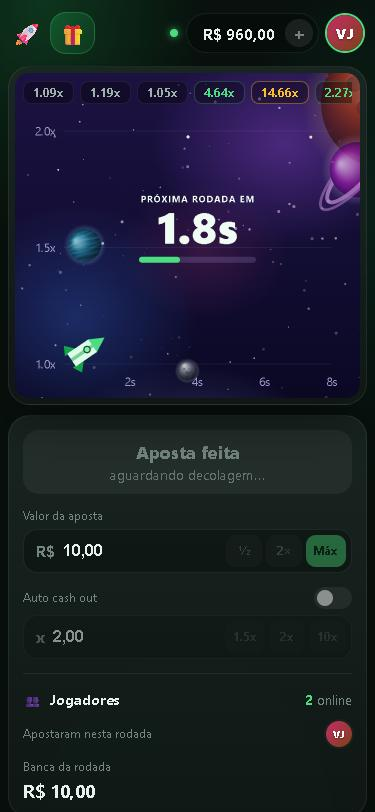

# 🚀 Rocket Crash

Protótipo jogável de um **crash game multiplayer em tempo real**, feito do zero com **React, TypeScript, PixiJS, REST e WebSocket**.

Um multiplicador começa em 1.00x e sobe até "crashar" num ponto aleatório. Você aposta antes da decolagem e precisa fazer **cash out** antes do crash: ganha `aposta × multiplicador`. Todos os jogadores conectados veem a mesma rodada, as apostas e os cash-outs uns dos outros ao vivo.

**Funcionalidades:** auto cash-out executado pelo servidor, aposta agendada para a próxima rodada, tabela de ganhadores ao vivo, contagem de jogadores online, fichas grátis com tempo de espera, recarga **simulada** com pacotes e código promocional (`ROCKET` dá +10%), página de perfil com estatísticas e atalho de teclado (Espaço).

> **Jogadores simulados:** para a sala parecer movimentada na demo, o servidor tem bots ([`bots.ts`](server/src/bots.ts)) que apostam a cada rodada. Eles não têm atalho: usam o mesmo `game.placeBet()` e o auto cash-out de um jogador real. Os dados pessoais do perfil também são fictícios (e-mails em `@example.com`).

> A recarga é só uma simulação de interface: nenhum dado de pagamento é pedido, e o servidor apenas credita fichas virtuais. Mesmo assim, ele valida o valor, a forma de pagamento e o código, e calcula o bônus sozinho. O cliente nunca diz "quanto de bônus quer".

> Fichas de mentira, sem dinheiro real. É um projeto de estudo e portfólio.

<p align="center"></p>

## Como rodar

Requer **Node.js 24**.

```bash
npm install
npm run dev          # servidor (3001) + cliente com hot reload (5173)
```

Abra http://localhost:5173. Para ver o jogo "multiplayer", abra em duas abas ou no celular.

**Produção** (o servidor entrega o cliente compilado, tudo na mesma origem):

```bash
npm run build
npm start            # http://localhost:3001
```

**No celular:** com o PC e o celular no mesmo Wi-Fi, acesse `http://<IP-do-PC>:5173` (dev) ou `:3001` (produção). O IP aparece no terminal do Vite como `Network`. No Windows, permita o Node no firewall quando ele perguntar.

**Modo debug:** acrescente `?debug` à URL para ver FPS, tempo por frame, custo do `update()` e partículas, direto no canvas. Funciona no celular também.

### Scripts úteis

| Comando | O que faz |
|---|---|
| `npm run typecheck` | Checa os tipos do cliente e do servidor |
| `npm run smoke -w server` | Joga uma rodada real contra o servidor e testa cada regra de validação (precisa do `npm run dev` rodando) |
| `npm run simulate -w server` | Simula 1 milhão de rodadas e mede o RTP |

## O que o projeto demonstra

| Requisito da vaga | Onde está |
|---|---|
| Mecânicas, interações e animações 2D com **PixiJS** | [`CrashScene.ts`](client/src/pixi/CrashScene.ts): curva, foguete, rastro de fumaça, explosão de partículas, tremor de tela, câmera dinâmica |
| Interfaces e componentes em **React + TypeScript** | [`components/`](client/src/components), [`hooks/`](client/src/hooks) |
| Integração com **REST APIs** | [`routes.ts`](server/src/routes.ts) (servidor) e [`api.ts`](client/src/net/api.ts) (cliente): apostar, cash out, sessão, saldo |
| Eventos em tempo real via **WebSockets** | [`realtime.ts`](server/src/realtime.ts) (broadcast, heartbeat, backpressure) e [`GameSocket.ts`](client/src/net/GameSocket.ts) (reconexão com backoff) |
| Fluidez e adaptação entre telas | Layout responsivo testado em 375px e 1280px, controles pensados para toque, resolução do canvas limitada a 2x |
| Profiling e debugging com evidências | Overlay `?debug`, números medidos abaixo e a seção [bugs encontrados](#bugs-encontrados-no-caminho) |

## Rotas

**Páginas** (React Router, no cliente):

| Rota | Página |
|---|---|
| `/` | Mesa do jogo |
| `/perfil` | Perfil do jogador: dados (fictícios, editáveis) e estatísticas reais |
| `*` | Página 404 "Perdido no espaço" |

O WebSocket, a sessão e as notificações ficam no `App`, acima das rotas, então trocar de página não derruba a conexão. Em produção, o Express devolve o `index.html` para qualquer `GET` fora de `/api` (fallback de SPA), e assim `/perfil` também funciona aberto direto pela URL.

**API REST** (Express, sob `/api`):

| Método | Rota | O que faz |
|---|---|---|
| `POST` | `/players` | Cria um jogador convidado e devolve o token |
| `GET` | `/players/me` | Nome, saldo e tempo até as próximas fichas grátis |
| `GET` / `PUT` | `/players/me/profile` | Lê / atualiza o perfil (validação compartilhada em `shared/profile.ts`) |
| `POST` | `/players/me/bonus` | Resgata fichas grátis (`429` se ainda estiver no tempo de espera) |
| `POST` | `/players/me/deposit` | Recarga **simulada** de fichas virtuais |
| `GET` | `/promo/:code` | Valida um código promocional |
| `POST` | `/bet` | Aposta (com auto cash-out opcional) |
| `POST` | `/cashout` | Sai da rodada no multiplicador atual |
| `GET` | `/round`, `/history` | Estado da rodada e últimos crashes |

Rotas inexistentes em `/api` devolvem `404` em JSON, no mesmo formato de erro do resto da API.

## Arquitetura

```
 NAVEGADOR                                           SERVIDOR (Node + Express + ws)
 ┌───────────────────────────────────┐              ┌────────────────────────────────┐
 │ React: UI, input, sessão          │── REST ─────►│ routes.ts: valida e chama      │
 │   BetPanel ─► api.bet / cashout   │  (ações)     │   ├─ game.ts (rodadas, regras) │
 │                                   │              │   └─ players.ts (carteira)     │
 │ gameReducer ◄── GameSocket ◄──────│◄─ WebSocket ─│ realtime.ts ◄── game.onEvent   │
 │      │ (ref)                      │  (eventos)   │                                │
 │ PixiJS: CrashScene (60-144fps)    │              │ CrashGame: betting → running → │
 └───────────────────────────────────┘              │            crashed → betting…  │
            shared/ (protocolo, tipos da API, matemática da curva) ◄────────────┘
```

### Como renderização, input, animação e estado se conectam

1. **Estado.** O servidor transmite eventos (`betting`, `tick`, `crashed`, `bet`, `cashout`). O [`gameReducer`](client/src/game/state.ts), uma função pura, transforma cada mensagem em um novo `GameState`.
2. **Animação.** A [`CrashScene`](client/src/pixi/CrashScene.ts) lê esse estado a cada frame, através de uma ref, sem passar pelo React. Como a curva é uma fórmula (`e^(0.00006·ms)`), ela **interpola** o multiplicador exato daquele frame, embora a rede mande apenas 10 ticks por segundo.
3. **Renderização.** O scene graph do Pixi (grade, curva, foguete, partículas, HUD) é desenhado via WebGL.
4. **Input.** Um clique ou a tecla Espaço vira uma chamada REST. O servidor valida e transmite o evento a todos pelo WebSocket, e o estado de todos os clientes é atualizado (passo 1).

## Decisões técnicas

- **O servidor é a autoridade.** O ponto de crash é sorteado no servidor com `crypto.randomInt` e só é revelado depois do crash. No cash-out, o cliente só *pede* para sair, e o servidor calcula o multiplicador pelo próprio relógio. Assim o jogador não consegue trapacear pelo DevTools.
- **REST para ações, WebSocket para eventos.** As ações têm resposta, status HTTP e são fáceis de testar. O WebSocket é só servidor → cliente: um broadcast que serializa uma vez e envia para todos.
- **Snapshot + deltas.** Quem conecta (ou reconecta) recebe o estado completo e, depois, só as mudanças. A reconexão usa *exponential backoff* com *jitter*.
- **Tempos relativos na rede.** As mensagens trazem `elapsedMs` e `durationMs`, nunca horários absolutos, então o relógio errado de um celular não afeta o jogo.
- **Auto cash-out no servidor.** O alvo fica guardado no servidor (não é público), e um `setTimeout` agendado em `msToReach(alvo)` paga exatamente o alvo, sem depender da latência da rede. Cash-out manual e automático passam pela mesma função `settle()`, então há um único caminho de pagamento.
- **Dinheiro em centavos inteiros, sempre arredondado para baixo.** A tela usa a mesma regra de arredondamento do servidor, então nunca promete um valor maior do que o que será pago.
- **Contrato compartilhado.** A pasta [`shared/`](shared) é importada pelos dois lados. Se um campo do protocolo mudar, o TypeScript acusa erro no cliente e no servidor ao mesmo tempo, e o `switch` do reducer é verificado como exaustivo.
- **Ponte entre React e PixiJS.** O React cria e destrói a cena, e o Pixi anima sozinho. O init assíncrono do Pixi v8 é protegido contra a montagem dupla do StrictMode.
- **Animação independente da taxa de quadros.** Tudo é baseado em `deltaMS`, e a suavização usa `1 - e^(-dt/τ)`. O jogo roda igual em telas de 60Hz e de 144Hz.

### Matemática

`crash = 0.99 / (1 - r)`, com `r` uniforme em [0, 1). Isso faz com que `P(crash ≥ m) = 0.99 / m`: qualquer que seja a estratégia de saída, o retorno esperado é **99%** (RTP), com 1% de vantagem da casa. A simulação de 1 milhão de rodadas confirma:

| Sai sempre em | Ganha em | RTP medido |
|---|---|---|
| 1.10x | 90.1% das rodadas | 99.06% |
| 2.00x | 49.6% das rodadas | 99.12% |
| 10.00x | 9.9% das rodadas | 99.15% |

## Profiling

Medido com o build de produção (`npm run build && npm start`) no Chrome desktop, monitor de 144Hz.

**Carregamento**

| Métrica | Valor |
|---|---|
| JS principal (React + React Router + PixiJS + jogo) | 613 KB → **189 KB com gzip** (o middleware `compression` reduz a transferência em ~70%). A primeira medição, antes do React Router e das telas novas, era 552 → 166 KB. |
| Transferido no primeiro acesso (HTML + CSS + JS) | ~247 KB |
| First Contentful Paint (localhost) | ~390 ms |
| Cache | Arquivos com hash em `/assets` usam `immutable, max-age=1y`. O `index.html` não tem cache longo. |

**Frames** (orçamento: 6,9 ms a 144Hz / 16,7 ms a 60Hz)

| Momento | FPS | Frame p95 | Pior frame | Custo do nosso `update()` |
|---|---|---|---|---|
| Em voo (43 partículas) | 143 | 7,0 ms | 9,5 ms | 0,11 ms (p95 0,2 ms) |
| Explosão (70 partículas) | 141 | 7,1 ms | 9,4 ms | 0,10 ms (p95 0,2 ms) |

Nossa lógica por frame usa **~1% do orçamento a 60fps**. O object pool mantém o total de sprites constante (vivas + no pool = 114 em todas as amostras), sem crescimento de memória.

Otimizações aplicadas e o motivo de cada uma:

- `BitmapText` no multiplicador: o texto muda todo frame, e um `Text` comum re-renderizaria a fonte a cada mudança.
- Uma textura compartilhada por todas as partículas: permite *batching* na GPU.
- *Object pool* e teto de 300 partículas: evitam pausas do garbage collector e garantem o FPS.
- `resolution` limitada a 2x: telas 3x custariam 2,25 vezes mais pixels, com diferença quase invisível.
- `Text` só é atualizado quando o conteúdo muda.

**Falta medir:** celulares reais. Para isso, use o checklist abaixo com `?debug`. Para simular um aparelho fraco no desktop, use DevTools → Performance → CPU 4x/6x slowdown.

### Checklist de teste em dispositivo real

- [ ] FPS e frame p95 no overlay `?debug` durante voo e explosão
- [ ] Girar a tela no meio de uma rodada (o canvas se redimensiona via `ResizeObserver`)
- [ ] Ir para outro app e voltar (a aba escondida pausa o rAF, o WebSocket reconecta se cair e a curva continua certa)
- [ ] Desligar o Wi-Fi por alguns segundos (aparece "Reconectando…" e o jogo volta sozinho)
- [ ] Focar o campo de valor no iPhone (não deve dar zoom; a fonte do input tem 16px)
- [ ] Tempo de carregamento no 4G (DevTools → Network → "Fast 4G" como referência)

## Bugs encontrados no caminho

Registro de problemas reais encontrados testando, e como foram diagnosticados:

| Sintoma | Causa | Como foi encontrado |
|---|---|---|
| Botão prometia R$ 11,72 com o canvas mostrando 1.17x (o servidor pagaria R$ 11,70) | A UI usava o multiplicador cru, e o `toFixed` arredonda para cima. O servidor usa `floor`. | Screenshot. A correção foi verificada medindo que todo valor exibido é múltiplo de R$ 0,10 e que o pago é ≥ o prometido. |
| Botões vazando do painel em telas de 375px | Em CSS Grid, `1fr` tem mínimo igual ao conteúdo. A solução foi `minmax(0, 1fr)`. | Screenshot no viewport mobile, depois medição dos `getBoundingClientRect` |
| Grade mostrando `1x, 6x, 11x` | As linhas partiam de 1 + n·passo, em vez de múltiplos do passo | Screenshot de uma rodada alta |
| `Invalid hook call` depois de adicionar o PixiJS | O Vite reotimizou as dependências e a aba ficou com duas cópias do React (hashes `v=` diferentes no stack trace) | Leitura do stack trace. Era um problema só do ambiente de dev. |
| Servidor de dev caindo com `EADDRINUSE :5173` depois de passar a ler `PORT` (para hospedagem) | A ferramenta que rodava o `npm run dev` definia `PORT=5173` (a porta do Vite) no ambiente. Em dev, a porta agora é fixa (`--dev` → 3001). | O smoke test final falhou sem saída. Encontrado nos logs do servidor. |
| Um `500` no console durante o reinício do servidor | Era o proxy do Vite com o backend fora do ar, e não a API (o `errorHandler` registra todo 500 no log, e o log estava vazio) | Comparação entre o log do servidor e o log do Vite |

## Limitações e próximos passos

- **Persistência:** jogadores e saldos ficam em memória e somem se o servidor reiniciar. O cliente detecta o `401` e cria uma conta nova. Próximo passo: um banco de dados (a interface `PlayerStore` não mudaria).
- **Escala horizontal:** o jogo roda num único processo. Com várias instâncias, o loop precisaria de um único dono, com os eventos distribuídos por pub/sub (Redis, por exemplo).
- **Latência no cash-out manual:** o servidor é a autoridade, então um clique em 2.00x pode chegar ao servidor em 2.03x. Para quem quer precisão, existe o **auto cash-out**, executado pelo próprio servidor no ponto exato.
- **Provably fair:** publicar o hash do resultado antes da rodada para o jogador poder verificá-lo depois.
- **Testes unitários:** o `gameReducer` e a matemática são funções puras, prontas para Vitest. Hoje a cobertura vem do smoke test de ponta a ponta e da simulação.
- **Bundle:** dá para carregar o PixiJS sob demanda (`import()`) e exibir a UI antes do canvas.

## Estrutura

```
shared/           contrato entre cliente e servidor
  protocol.ts       mensagens do WebSocket (discriminated union)
  api.ts            tipos da REST API, limites, códigos de erro
  crash-math.ts     curva do multiplicador (usada pelos dois lados)
server/src/
  game.ts           máquina de estados da rodada, apostas, cash-out
  crash-point.ts    sorteio do crash (só no servidor)
  players.ts        jogadores e carteira (em memória)
  routes.ts         REST API + tratamento de erros
  realtime.ts       WebSocket: snapshot, broadcast, heartbeat
server/scripts/     smoke test e simulação de RTP
client/src/
  pixi/CrashScene.ts       a cena do jogo (game loop, partículas, câmera)
  game/state.ts            reducer: mensagens → estado
  net/                     cliente REST e WebSocket com reconexão
  hooks/                   useGameSocket, useSession, useToasts
  pages/                   GamePage (/), ProfilePage (/perfil), NotFoundPage (*)
  components/              BetPanel, GameCanvas, LiveWinners, PlayersSummary, TopBar, DepositModal…
```
